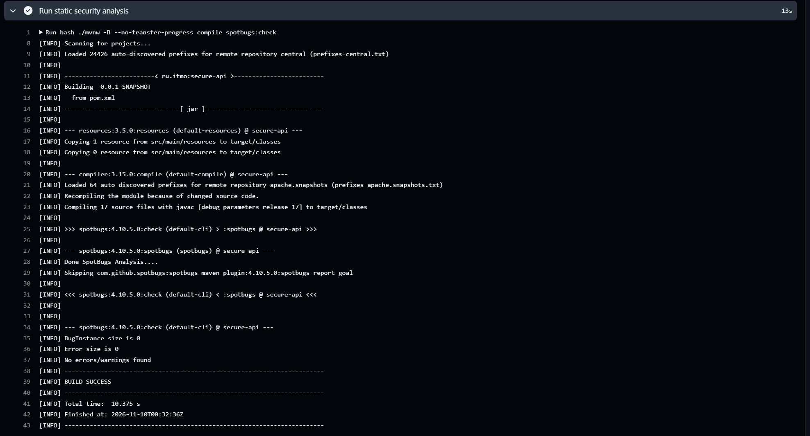
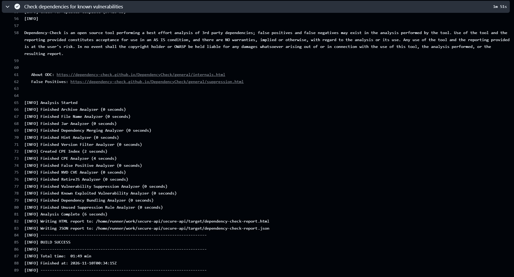
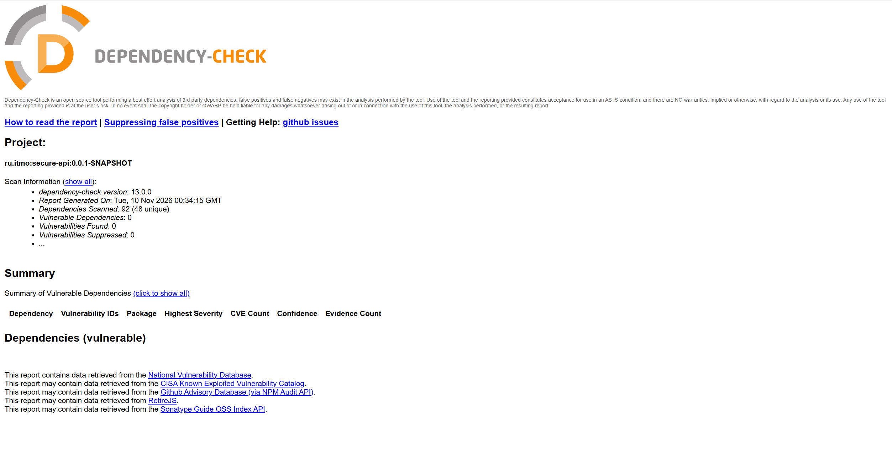

# Лабораторная работа №1

**Разработка защищённого REST API с интеграцией в CI/CD**

API для личных заметок: пользователь входит по логину и паролю, создаёт заметки и получает только собственные записи.

**Стек:** Java 17+, Spring Boot, Spring Security, Hibernate / Spring Data JPA, PostgreSQL, Maven, GitHub Actions.

## Запуск

1. Создать базу PostgreSQL `secure_api` и пользователя `secure_api_user`, которому она принадлежит.
2. В конфигурации запуска IntelliJ IDEA задать переменные окружения:
    - `DB_PASSWORD` — пароль пользователя PostgreSQL;
    - `JWT_SECRET` — случайный ключ длиной не менее 32 байт, закодированный в Base64.
3. Для первоначального создания пользователя добавить:
    - `APP_BOOTSTRAP_ENABLED=true`;
    - `BOOTSTRAP_USERNAME=student`;
    - `BOOTSTRAP_PASSWORD` — пароль от 12 символов, не более 72 байт UTF-8.
4. Запустить `SecureApiApplication`. После создания пользователя удалить три переменные `BOOTSTRAP` из конфигурации запуска.

Адрес API: `http://localhost:8080`.

## Методы API

Для запросов с телом используется `Content-Type: application/json`.

### POST /auth/login

Аутентификация пользователя. Тело запроса:

```json
{
  "username": "student",
  "password": "<пароль пользователя>"
}
```

Успешный ответ — `200 OK`, поля `accessToken` и `tokenType: Bearer`. Неверные учётные данные — `401 Unauthorized`, некорректные входные данные — `400 Bad Request`.

### GET /api/data

Получение собственных заметок. Необходим заголовок:

```http
Authorization: Bearer <accessToken>
```

Успешный ответ — `200 OK` и массив заметок. Без токена, с недействительным или просроченным токеном — `401 Unauthorized`.

### POST /api/data

Создание заметки. Требуется тот же заголовок авторизации. Тело запроса:

```json
{
  "content": "Моя первая заметка"
}
```

Успешный ответ — `201 Created` с идентификатором и текстом заметки.

При действительном JWT пустой текст или текст длиннее 2000 символов возвращает `400 Bad Request`. Без JWT и CSRF-токена запрос отклоняется с `403 Forbidden`. При недействительном или просроченном Bearer-токене — `401 Unauthorized`.

## Реализованные меры защиты

### SQL-инъекции

Используется ORM Hibernate. Spring Data JPA передаёт значения параметрами; SQL не собирается конкатенацией пользовательского ввода.

Фрагмент `UserRepository`:

```java
public interface UserRepository extends JpaRepository<AppUser, Long> {
    Optional<AppUser> findByUsername(String username);
}
```

### XSS

Текст экранируется при формировании ответа в `NoteResponse`. В базе сохраняется исходное значение.

```java
public static NoteResponse from(Note note) {
    return new NoteResponse(
            note.getId(),
            HtmlUtils.htmlEscape(note.getContent(), "UTF-8")
    );
}
```

Например, `<script>alert(1)</script>` возвращается как `&lt;script&gt;alert(1)&lt;/script&gt;`. Это экранирование для HTML-текста; браузерный интерфейс также должен безопасно отображать полученные данные.

### Аутентификация и пароли

Пароли хэшируются BCrypt с параметром сложности 12:

```java
@Bean
public PasswordEncoder passwordEncoder() {
    return new BCryptPasswordEncoder(12);
}
```

При создании пользователя в PostgreSQL сохраняется только хэш:

```java
String hash = passwordEncoder.encode(password);
AppUser user = new AppUser(username, hash);
userRepository.save(user);
```

При входе `AuthenticationManager` проверяет пароль через настроенный `DaoAuthenticationProvider` и `PasswordEncoder`. При успешной проверке выдаётся JWT с подписью HS256 и сроком действия 15 минут.

Фрагмент `JwtConfig`, задающий проверку подписи, издателя и временных ограничений:

```java
NimbusJwtDecoder decoder = NimbusJwtDecoder
        .withSecretKey(jwtSecretKey)
        .macAlgorithm(MacAlgorithm.HS256)
        .build();

decoder.setJwtValidator(
        JwtValidators.createDefaultWithIssuer(issuer)
);
```

Встроенный фильтр Spring Security проверяет Bearer-токен перед доступом к защищённым методам:

```java
.requestMatchers(HttpMethod.POST, "/auth/login").permitAll()
.requestMatchers("/api/**").authenticated()
.anyRequest().denyAll()
```

### Разграничение доступа

Владелец определяется из идентификатора в проверенном JWT. Клиент не выбирает владельца через тело запроса. Получение заметок ограничено его идентификатором:

```java
AppUser owner = getCurrentUser(subject);

return noteRepository
        .findAllByOwner_IdOrderByIdAsc(owner.getId())
        .stream()
        .map(NoteResponse::from)
        .toList();
```

Дополнительно реализованы валидация входных полей, ответы через DTO без хэшей паролей и запрет кэширования ответа с JWT. Секреты передаются через переменные окружения.

CSRF глобально не отключён: для JSON-входа задано точечное исключение, Bearer-запросы обрабатываются стандартной настройкой Resource Server. Форма входа и HTTP Basic отключены. Поэтому POST без Bearer-токена и CSRF-токена может отклоняться CSRF-фильтром со статусом `403` до проверки аутентификации.

## CI/CD

Конфигурация: `.github/workflows/ci.yml`.

При каждом push и pull request запускаются три независимые задачи:

- **API tests** — автоматические проверки отказа в доступе к GET `/api/data` без токена и с некорректным токеном. Используется отдельная PostgreSQL.
- **SAST** — SpotBugs с FindSecBugs, максимальное усилие анализа и стандартный порог отчётности.
- **SCA** — OWASP Dependency-Check с официальными файлами NVD. Уязвимости с CVSS от 7 блокируют проверку.

Отчёты сохраняются в Artifacts: `test-reports`, `sast-reports`, `sca-reports`.

### Результат SAST



### Результат SCA





## Проверка API

В Postman проверены:

- успешный вход — `200`, неверный пароль — `401`;
- GET `/api/data` без JWT — `401`;
- POST `/api/data` без JWT и CSRF-токена — `403`;
- GET с повреждённой подписью JWT — `401`;
- создание заметки с действительным JWT — `201`, получение списка — `200`;
- пустая заметка с действительным JWT — `400`;
- попытка SQL-инъекции в логине — `401`;
- экранирование HTML в ответах;
- изоляция заметок двух пользователей.